<div align="center">

# AiXenix Video Laws

**10 законов — 10 способов нарисовать рекламу кодом.**<br>
Скиллы для Claude Code: каждый ролик рождается по одному жёсткому правилу, и сам способ создания картинки становится зрелищем.

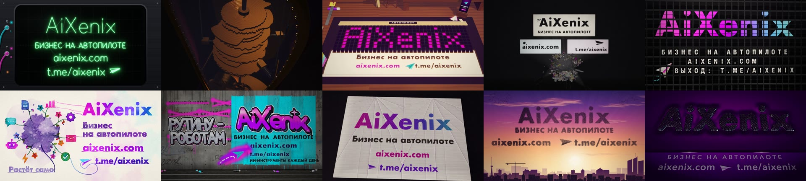

[](LICENSE)


[Установка](#установка) · [Галерея](#галерея-10-законов) · [Как это работает](#как-это-работает) · [English](#english)

</div>

---

Ни одного кадра видеогенерации и ни одной стоковой картинки. Каждый пиксель рисует JavaScript (Canvas2D, three.js/WebGL, свои симуляции), каждый звук синтезирован в коде, кадр — чистая функция времени. Код написан Claude Code (Opus 5.5) по скиллу [procedural-film](https://github.com/kuhnhomeuk-cell/procedural-film).

Главная идея — **закон метода**. Красивая текстура — это ещё не стиль. Стиль — это правило, по которому возникает всё изображение, и зритель его считывает: «всё рисует один луч», «ничего не нарисовано, всё делает стая», «одно касание — дальше само». Каждый из десяти скиллов — такой закон плюс движок, который его честно исполняет, плюс полный рабочий пример.

## Установка

**Как плагин Claude Code** (все 12 скиллов разом):

```bash
claude plugin marketplace add AiXenix/aixenix-video-skills
claude plugin install aixenix-video@aixenix
```

Скиллы появятся как `/aixenix-video:law-splitflap`, `/aixenix-video:law-murmuration` и т. д. Можно просто попросить: «Сделай рекламу моего сервиса в стиле табло вылетов».

**Вручную** (один или несколько скиллов):

```bash
git clone https://github.com/AiXenix/aixenix-video-skills.git
ln -s "$PWD/aixenix-video-skills/skills/law-splitflap" ~/.claude/skills/law-splitflap
ln -s "$PWD/aixenix-video-skills/skills/aixenix-video" ~/.claude/skills/aixenix-video
ln -s "$PWD/aixenix-video-skills/skills/procedural-film" ~/.claude/skills/procedural-film
```

**Требования:** Node.js 20+, ffmpeg в `PATH`, Chromium для Playwright (`npx --prefix <пример>/tools playwright install chromium`), агент со скиллами и субагентами — например, Claude Code.

**Свой ролик за 5 команд** (на примере табло):

```bash
cp -R skills/law-splitflap/example my-ad && cd my-ad
npm --prefix tools ci && npx --prefix tools playwright install chromium
FILM_NO_NET=1 node tools/check.cjs        # гейт: детерминизм, тайминг, цена кадра
FILM_NO_NET=1 node tools/render.cjs       # exports/*.mp4
```

Где менять тексты, цвета, ссылки и музыку — в разделе «Make it yours» в `SKILL.md` каждого закона.

## Галерея: 10 законов

Все ролики — реклама [AiXenix](https://aixenix.com) («Бизнес на автопилоте», [t.me/aixenix](https://t.me/aixenix)), 19–24 с, 1920×1080, 30 fps, последний такт — бесшовная петля. Видео со звуком лежат в [Releases](https://github.com/AiXenix/aixenix-video-skills/releases/tag/v1.0.0).

### 01 · Осциллограф — звук рисует картинку
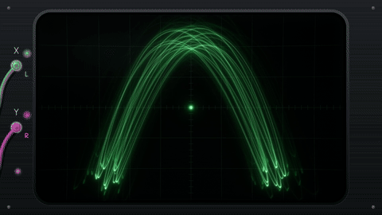

**Закон:** всё на экране — след одного электронного луча, X и Y которого — левый и правый каналы саундтрека. Что слышишь, то и видишь: декодированный звук готового mp4, поданный на настоящий осциллограф в режиме X-Y, рисует те же кадры. Частота обхода фигуры — это высота ноты, буквы обходятся с частотой, кратной кадру, поэтому стоят неподвижно.

▶ [Смотреть со звуком](https://github.com/AiXenix/aixenix-video-skills/releases/download/v1.0.0/law-oscilloscope.mp4) · [скилл `law-oscilloscope`](skills/law-oscilloscope)

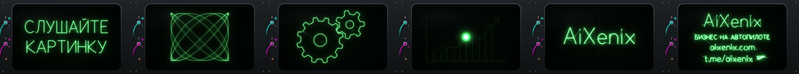

### 02 · Автоматон 1774 — всё пишет механизм
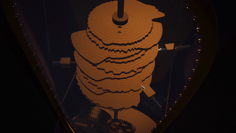

**Закон:** ничего не появляется, чего не сделала машина. Часовой писец в духе Жаке-Дро выводит гусиным пером каждую букву, а весь путь пера записан в профилях латунных кулачков: камера заглядывает под стекло, и видно, как толкатели читают надпись. «Автоматизация с 1774 года. Теперь с ИИ».

▶ [Смотреть со звуком](https://github.com/AiXenix/aixenix-video-skills/releases/download/v1.0.0/law-automaton.mp4) · [скилл `law-automaton`](skills/law-automaton)


### 03 · Цепная реакция — одно касание, дальше само
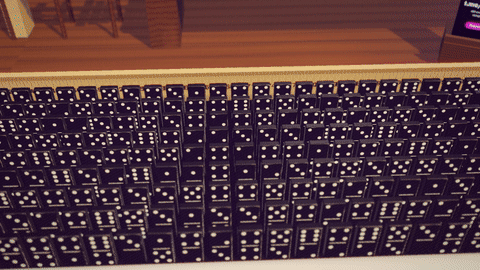

**Закон:** палец толкает одно домино — и дальше машина Голдберга делает всё сама одним планом: заявка → CRM → счёт → оплата → самолётик жмёт «Подписаться». Каждый удар — нота джингла: зазоры домино и бруски ксилофона рассчитаны по партитуре. Финал — 315 домино падают рядами, и их спинки складываются в «AiXenix».

▶ [Смотреть со звуком](https://github.com/AiXenix/aixenix-video-skills/releases/download/v1.0.0/law-chain-reaction.mp4) · [скилл `law-chain-reaction`](skills/law-chain-reaction)


### 04 · Тень — картинку рисует только тень
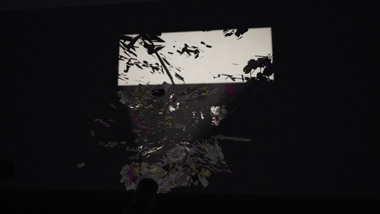

**Закон:** изображение никогда не рисуется. Облако офисного хлама вращается под тремя прожекторами, и под точными углами его тень защёлкивается в буквы. Солвер расставил около 2800 обрывков так, чтобы все семь теней совпали без единой дыры.

▶ [Смотреть со звуком](https://github.com/AiXenix/aixenix-video-skills/releases/download/v1.0.0/law-shadow.mp4) · [скилл `law-shadow`](skills/law-shadow)


### 05 · Табло вылетов — только механические лепестки
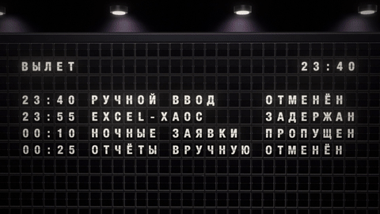

**Закон:** всё — только табло Solari из 504 модулей. Каждый модуль листает свой барабан строго по одному лепестку, и картинки собираются мозаикой лепестков. Каждый удар лепестка — щелчок в саундтреке, около 40 000 щелчков. «РУЧНОЙ ВВОД — ОТМЕНЁН», лайнер взлетает флипбуком, «ВЫХОД: T.ME/AIXENIX».

▶ [Смотреть со звуком](https://github.com/AiXenix/aixenix-video-skills/releases/download/v1.0.0/law-splitflap.mp4) · [скилл `law-splitflap`](skills/law-splitflap)

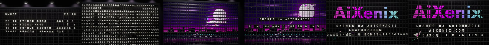

### 06 · Акварель по-мокрому — растёт само
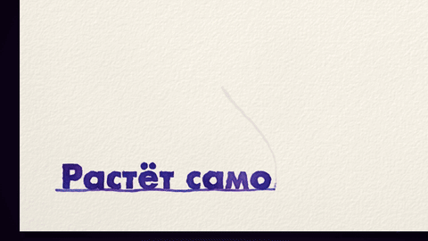

**Закон:** ничего не рисуется рукой. На бумагу ложится чистая вода, падает капля, и цвет сам распускается по мокрым дорожкам: фронт пигмента, затёки, кольца высыхания, соль. Буквы рождаются так же — из мокрой нити снизу вверх.

▶ [Смотреть со звуком](https://github.com/AiXenix/aixenix-video-skills/releases/download/v1.0.0/law-watercolor.mp4) · [скилл `law-watercolor`](skills/law-watercolor)


### 07 · Граффити — стену красят баллоны без рук
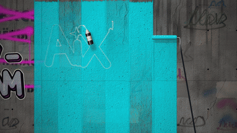

**Закон:** стену расписывает бригада баллонов без рук, валик на шесте и трафареты. Распыл с ореолом и крапом, подтёки стекают по гравитации, трафареты срываются в такт. «РУТИНУ — РОБОТАМ», дроп четырёх баллонов на «AiXenix», мимо проносится электричка.

▶ [Смотреть со звуком](https://github.com/AiXenix/aixenix-video-skills/releases/download/v1.0.0/law-graffiti.mp4) · [скилл `law-graffiti`](skills/law-graffiti)

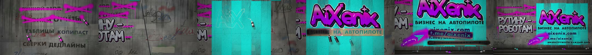

### 08 · Один лист — ни одного разреза
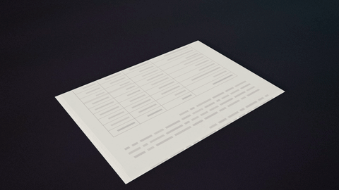

**Закон:** один лист A4, ни разреза, ни клея, сам складывается из фигуры в фигуру — шестерня, стрела, самолётик. Каждый сгиб остаётся на бумаге линией. В финале самолётик раскрывается открыткой, и косой свет зажигает все накопленные складки вокруг призыва.

▶ [Смотреть со звуком](https://github.com/AiXenix/aixenix-video-skills/releases/download/v1.0.0/law-origami.mp4) · [скилл `law-origami`](skills/law-origami)

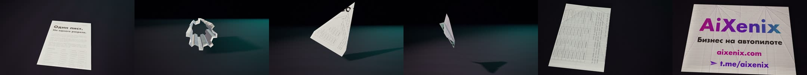

### 09 · Мурмурация — ничего не нарисовано, всё делает стая


**Закон:** каждая фигура и каждая буква — силуэт живой стаи из 30 000 скворцов на закате. Птицы машут, кренятся, по стае бегут волны плотности, и каждая птица сохраняет себя от фигуры к фигуре. «30 000 птиц — ни одного пилота».

▶ [Смотреть со звуком](https://github.com/AiXenix/aixenix-video-skills/releases/download/v1.0.0/law-murmuration.mp4) · [скилл `law-murmuration`](skills/law-murmuration)


### 10 · Феррофлюид — невидимый магнит


**Закон:** чёрная магнитная жидкость на стальной плите, а невидимые магниты снизу «печатают» каждую картинку шипами Розенцвейга — шестерню, буквы, самолётик с кильватером. Шипы отражаются друг в друге, финальная плашка проявляется гравировкой на стали.

▶ [Смотреть со звуком](https://github.com/AiXenix/aixenix-video-skills/releases/download/v1.0.0/law-ferrofluid.mp4) · [скилл `law-ferrofluid`](skills/law-ferrofluid)

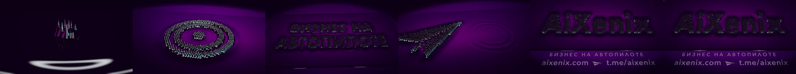

## Как это работает

```
skills/
├── aixenix-video/      скилл-роутер: выбор закона, общий движок (engine/ = шаблон проекта + three.js r180)
├── procedural-film/    пайплайн (MIT, Dean Kuhn): гейт, рендер, звук, документы планирования
└── law-*/              10 законов: SKILL.md (как сделать свой ролик), README.md, example/ (полный проект)
media/                  баннер, превью и раскадровки для этого README
```

- **Кадр = функция времени.** Никаких `Math.random`/`Date`; симуляции (стая, домино, тени, жидкость) считаются с фиксированным шагом при загрузке, поэтому кадры можно рендерить параллельно и в любом порядке. Гейт `tools/check.cjs` рендерит кадры пятью способами (холодно, подряд, вперёд, назад, вперемешку) и сравнивает хэши.
- **Рендер:** Chromium без окна кадр за кадром → ffmpeg. three.js собран в обычный скрипт `src/vendor.js` (EffectComposer, bloom, DOF, SMAA, геометрии, шумы).
- **Звук:** синтез в Web Audio прямо в проекте; удары стоят на событиях картинки с точностью до 7 мс. В осциллографе звук и картинка — буквально одни и те же сэмплы.
- **Процесс:** тестовый кадр метода → раскадровка → таймлайн → сцены → музыка → жёсткий критик-субагент → правки → сдача.

## Как придумать свой закон

1. **Правило:** что создаёт каждый пиксель и что запрещено.
2. **Честный движок**, который правило исполняет — физика, механика, оптика или симуляция, а не обычная анимация «под вид».
3. **Камера**, которая показывает правило в работе.
4. **Одна метафора**, связывающая правило с посылом.
5. **Тест критика:** «можно ли это сделать обычной анимацией?» — если да, это ещё не закон.

Подробнее — в [`skills/aixenix-video/SKILL.md`](skills/aixenix-video/SKILL.md).

## Благодарности и лицензии

- Пайплайн [procedural-film](https://github.com/kuhnhomeuk-cell/procedural-film) — © 2026 Dean Kuhn, MIT (`skills/procedural-film/`).
- [three.js](https://threejs.org) r180 — © 2010–2025 three.js authors, MIT (встроен в `src/vendor.js`).
- Всё остальное — © 2026 AiXenix, [MIT](LICENSE). Подробно — [THIRD_PARTY_NOTICES.md](THIRD_PARTY_NOTICES.md).

Сделано в [AiXenix](https://aixenix.com) — ИИ-автоматизация бизнеса под ключ. ИИ-инструменты каждый день: **[t.me/aixenix](https://t.me/aixenix)**.

---

## English

**AiXenix Video Laws** is a Claude Code plugin with ten skills for making short ads entirely in code (Canvas2D, three.js/WebGL, custom simulations, synthesised sound, zero video generation). Each skill is a **law of the method**: one strict rule creates every pixel, and the viewer can read it. The laws are an oscilloscope where the soundtrack draws the picture, a 1774 clockwork writer, a Rube Goldberg chain reaction, shadow sculpture, a split-flap board, wet watercolour, live graffiti, one-sheet origami, a starling murmuration, and ferrofluid. Every law ships with a complete working example (a 19–24 s AiXenix ad) and instructions for making your own.

Install: `claude plugin marketplace add AiXenix/aixenix-video-skills` then `claude plugin install aixenix-video@aixenix`. Requirements: Node 20+, ffmpeg, Playwright Chromium. Built on [procedural-film](https://github.com/kuhnhomeuk-cell/procedural-film) (MIT). Videos with sound are in the v1.0.0 release.
